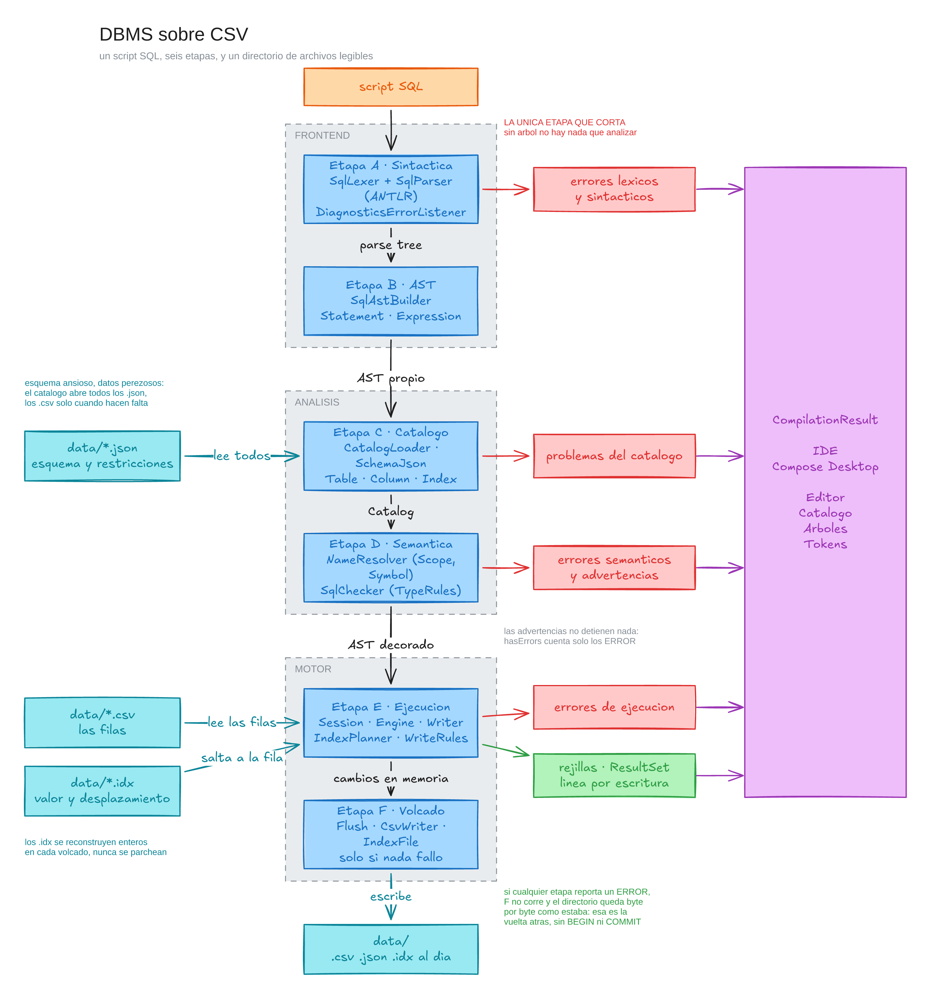

# DBMS sobre CSV

Manejador de base de datos escrito en Kotlin que pasa el SQL por las mismas
etapas de un compilador, léxico, sintáctico, semántico y ejecución, y guarda cada
tabla como un archivo CSV que se puede abrir con cualquier editor de texto.

Todo se maneja desde un IDE de escritorio escrito en Compose Multiplatform: se
escribe el script, se corre, y la ventana muestra las rejillas de resultados, los
errores, el catálogo de la base y los árboles del análisis.

Proyecto del curso de Diseño de Lenguajes de Programación, Universidad del Valle
de Guatemala.

---

## Qué hace

El motor no es un intérprete que lee el texto y actúa, sino una cadena de seis
etapas donde cada una agrega información sobre el mismo AST en lugar de construir
uno nuevo. El árbol se arma una sola vez, el análisis de nombres lo decora con los
ámbitos y los símbolos, el de tipos con el tipo de cada expresión, y el motor lo
recorre al final confiando en todo eso. Cada etapa queda chica y se prueba por
separado, porque no tiene que rehacer el trabajo de la anterior.

| Etapa | Componentes | Produce |
|---|---|---|
| A, sintáctica | `SqlLexer`, `SqlParser` (ANTLR), `DiagnosticsErrorListener` | el árbol de análisis |
| B, AST | `SqlAstBuilder` | el AST propio |
| C, catálogo | `CatalogLoader` | el esquema de la base, leído de los `.json` |
| D, semántica | `NameResolver`, `SqlChecker` | el AST decorado con símbolos y tipos |
| E, ejecución | `Session`, `Engine`, `Writer` | las rejillas y los cambios en memoria |
| F, volcado | `Flush` | los archivos del directorio `data/` |



El diagrama editable está en `docs/arquitectura.excalidraw`, que se abre en
excalidraw.com o en la extensión de VS Code.

Todo se orquesta desde una sola llamada, `DbmsPipeline.run(fuente, directorio)`,
que devuelve un `CompilationResult` con el árbol de ANTLR, el AST, el catálogo, el
árbol de ámbitos, los resultados y los errores. La interfaz llama una vez y de ahí
en adelante solo lee campos.

**La etapa sintáctica es la única que corta.** Sin árbol no hay nada que analizar.
Todas las demás reportan y siguen, así que un script con cinco problemas los
muestra los cinco de una vez y no uno por corrida.

---

## El SQL que entiende

| | Incluye |
|---|---|
| DDL | `CREATE TABLE`, `ALTER TABLE` para agregar y quitar columnas, `DROP TABLE` |
| Índices | `CREATE INDEX`, `DROP INDEX`, de una sola columna |
| DML | `INSERT` de varias filas, `UPDATE`, `DELETE` |
| Consultas | `SELECT`, `FROM`, alias, `JOIN ... ON`, `WHERE`, `ORDER BY`, `DISTINCT`, `LIMIT` |
| Agregación | `COUNT`, `SUM`, `AVG`, `MIN`, `MAX`, `GROUP BY`, `HAVING` |
| Subconsultas | escalares, `IN`, `EXISTS`, correlacionadas, y en el `FROM` |
| Tipos | `INT`, `FLOAT`, `DECIMAL`/`NUMERIC`, `CHAR`, `VARCHAR`, `TEXT`, `DATE`, `TIME`, `BOOLEAN` |
| Restricciones | `PRIMARY KEY`, `NOT NULL`, `NULL`, `UNIQUE`, `FOREIGN KEY`, `AUTOINCREMENT`, `DEFAULT` |

Queda fuera a propósito: transacciones explícitas, vistas, disparadores, `LEFT` y
`RIGHT JOIN`, `UNION`, `CHECK`, usuarios, índices compuestos y planificación por
costos.

Las palabras clave quedan reservadas, así que una columna no se puede llamar
`date`, `key`, `text` ni `count`.

---

## Cómo se guarda la base

**El directorio es el catálogo.** Si existe `users.csv`, existe la tabla `users`.
No hay un archivo global que liste las tablas, porque sería información derivada
de algo que el sistema de archivos ya sabe, y toda copia se puede quedar vieja.

Cada tabla son dos archivos. El CSV guarda el encabezado y las filas, y el JSON
guarda el tipo y las restricciones de cada columna, más los índices que tiene. El
CSV no puede cargar tipos y el JSON no debería cargar datos.

```
data/users.csv
──────────────
id,nombre,correo,activo
1,Ana,ana@ej.com,true
2,Bruno,bruno@ej.com,true
```

```json
{
    "columns": {
        "id":     { "type": "INT",         "constraints": [ { "constraint": "PRIMARY_KEY" },
                                                            { "constraint": "AUTOINCREMENT" } ] },
        "nombre": { "type": "VARCHAR(40)", "constraints": [ { "constraint": "NOT_NULL" } ] },
        "correo": { "type": "VARCHAR(60)", "constraints": [ { "constraint": "UNIQUE" } ] },
        "activo": { "type": "BOOLEAN",     "constraints": [ { "constraint": "DEFAULT", "value": "true" } ] }
    },
    "indexes": {
        "pk_users": "id",
        "uq_users_correo": "correo"
    }
}
```

Un índice es un tercer archivo, con extensión `.idx` para que el directorio no lo
confunda con una tabla. Es un CSV de dos columnas ordenado por valor, donde el
segundo número es el byte en que arranca esa fila dentro del `.csv`:

```
data/pk_users.idx
─────────────────
value,offset
1,25
2,48
```

Con eso, `WHERE id = 2` salta al byte 48 y lee una sola fila en vez de recorrer el
archivo completo. La clave primaria y las columnas `UNIQUE` traen su índice sin
que nadie escriba un `CREATE INDEX`, bajo los nombres reservados `pk_<tabla>` y
`uq_<tabla>_<columna>`.

**El DBMS es el único que escribe.** El CSV se eligió por legible, no por
editable. Hay una guarda que compara el encabezado del archivo contra el esquema y
avisa si alguien lo tocó por fuera, pero es eso, una guarda de cordura, no un
mecanismo de reconciliación. Lo que se valida de verdad es lo que entra.

---

## Ejecutar

```bash
./gradlew run
```

Abre el IDE. Si tienes varias versiones de Java instaladas, exporta `JAVA_HOME`
apuntando a un JDK 21 antes de correrlo:

```bash
# macOS Corretto
export JAVA_HOME=/Library/Java/JavaVirtualMachines/amazon-corretto-21.jdk/Contents/Home

# macOS Temurin (Adoptium)
export JAVA_HOME=/Library/Java/JavaVirtualMachines/temurin-21.jdk/Contents/Home

# Linux, ajusta el path según tu distro
export JAVA_HOME=/usr/lib/jvm/java-21-openjdk

# Windows PowerShell
$env:JAVA_HOME = "C:\Program Files\Eclipse Adoptium\jdk-21"
```

Gradle y ANTLR no hay que instalarlos. El proyecto trae el wrapper, y el plugin
`antlr` genera el lexer y el parser desde `app/src/main/antlr/Sql.g4` en cada
build, así que basta con clonar y compilar.

Al arrancar se carga el recorrido completo del SQL, un script que se arma su
propia base, la consulta de todas las formas posibles y la borra al final. El
selector que está sobre el editor permite cargar cualquiera de los 95 scripts de
la batería, agrupados por tema, o empezar en blanco.

### Las cuatro vistas

Se cambia entre ellas desde el menú **Vista**.

- **Editor**, el script con resaltado de sintaxis, una rejilla por cada `SELECT`,
  una línea por cada sentencia que escribió algo, la lista de errores y el resumen
  de lo que se volcó al disco. Los errores salen ordenados por línea en vez de
  agrupados por etapa, porque el script se lee de arriba hacia abajo, y al hacer
  clic sobre uno el editor salta a esa línea.
- **Catálogo**, las tablas de la base con sus columnas, tipos, restricciones e
  índices.
- **Árboles**, el árbol sintáctico de ANTLR, el AST propio y el árbol de ámbitos,
  que es donde se ve qué resolvió el análisis de nombres.
- **Tokens**, la tira de tokens tal como la produjo el lexer.

---

## Pruebas

```bash
./gradlew test
```

El reporte queda en `app/build/reports/tests/test/index.html`.

La batería tiene dos niveles. Por un lado están las pruebas unitarias sobre cada
componente por separado, y por otro, 95 scripts `.sql` reales que atraviesan el
pipeline completo: 40 que tienen que correr limpios, 52 que tienen que fallar, uno
por regla, y 3 que solo advierten y por eso sí se ejecutan.

Cada script declara su propia especificación en comentarios, así que el archivo es
su propia documentación, y agregar un caso es agregar un archivo sin tocar código
de pruebas. Ese archivo nuevo aparece también en el selector del IDE, bajo el
grupo de la carpeta donde cayó.

```sql
-- NOMBRE: Subconsulta correlacionada
-- ESPERADO: sin errores
-- FILAS: 2
```

```sql
-- NOMBRE: Columna del SELECT sin agrupar
-- ESPERADO: error
-- MENSAJE: no esta en el GROUP BY
-- LINEA: 16
```

- `NOMBRE`, el nombre que aparece en el selector del IDE.
- `ESPERADO`, una de tres: `sin errores`, `error` o `advertencia`.
- `FILAS`, cuántas filas devuelve el último `SELECT` del script.
- `MENSAJE` y `LINEA`, un fragmento del error esperado y dónde sale. Se verifica
  el fragmento y no el texto completo, para que mejorar la redacción de un mensaje
  no rompa la batería.

**Cada script es autosuficiente.** Crea sus tablas, las llena, las consulta y las
borra, así que se puede correr en cualquier orden, las veces que haga falta, y
sobre una base vacía. La batería verifica justamente eso, que el directorio quede
como estaba, lo cual de paso prueba que un script que falla a la mitad no deja
rastro.

---

## Compilar y empaquetar

```bash
./gradlew build
```

El plugin de Compose Desktop genera instaladores nativos sin dependencias
adicionales:

```bash
./gradlew packageDmg    # macOS
./gradlew packageMsi    # Windows
./gradlew packageDeb    # Linux
```

Los instaladores quedan en `app/build/compose/binaries/main/<formato>/`.

---

## Las decisiones de diseño

Están desarrolladas en `docs/roadmap/README.md`. En una línea cada una:

1. **Proyecto hermano, no evolución.** Compiscript queda congelado en `main` y
   aquí se reaprovechan los cimientos, no el lenguaje.
2. **El directorio es el catálogo.** Si existe el `.csv`, existe la tabla.
3. **Dos archivos por tabla**, porque el CSV no puede cargar tipos y el JSON no
   debería cargar datos.
4. **El DBMS es el único que escribe**, y lo que se valida de verdad es lo que
   entra.
5. **Se escribe al final**, así que si cualquier sentencia falla el directorio
   queda intacto, que es atomicidad por script sin agregar `BEGIN` ni `COMMIT` a
   la gramática.
6. **Las restricciones son una jerarquía sellada**, de modo que los estados
   imposibles no compilan.
7. **El JSON es uniforme**, cada regla es un objeto con discriminador.
8. **El semántico decora y el motor no vuelve a preguntar**, así que cada columna
   se lee indexando un arreglo y no buscando un nombre por fila.
9. **`CHAR` se guarda sin relleno**, que se aplica al leer, para que el CSV siga
   siendo legible.
10. **Una `Session` por corrida es la dueña del estado**, y su caché de lectura y
    su almacén de escritura son el mismo mapa, de forma que un `SELECT` después de
    un `INSERT` ve la fila nueva.
11. **Los índices guardan desplazamientos en bytes**, se reconstruyen enteros en
    cada volcado en vez de parcharse, y en memoria son un `TreeMap` del JDK, que
    resuelve igualdad y rangos.
12. **`PRIMARY KEY` y `UNIQUE` generan su índice**, y lo que gana no son las
    escrituras sino las consultas.
13. **Las advertencias son una severidad, no un colector aparte**, así que un
    script que solo advierte se ejecuta igual.

---

## Simplificaciones conscientes

Son las decisiones donde se eligió lo simple sabiendo lo que se dejaba fuera.

- **El join es por bucles anidados**, sin usar índices. Es cuadrático, y es el
  único lugar al que hay que volver si el volumen de datos crece.
- **`AUTOINCREMENT` reúsa números.** El siguiente valor es el máximo más uno, así
  que borrar la última fila devuelve ese número a la circulación.
- **El volcado es atómico por tabla, no entre tablas.** No hay diario de
  transacciones, así que un script que modifica dos tablas y falla al escribir la
  segunda deja la primera ya escrita. Lo que sí está garantizado es que un error
  antes del volcado no escribe nada.
- **La escala del `DECIMAL` al multiplicar no sigue el estándar al pie de la
  letra.** La precisión crece como manda el estándar, pero al dividir se eligieron
  seis decimales de más, que es lo que hace SQL Server, porque el estándar deja
  ese caso sin definir.
- **Si hay índice utilizable, se usa**, sin medir si conviene. Un `WHERE` que casa
  con la mitad de la tabla hace la mitad de los saltos, y eso puede salir más
  lento que leer el archivo de corrido. Un DBMS real guarda estadísticas de
  cardinalidad para decidirlo; aquí no hay planificador por costos.
- **Un `WHERE` usa un solo índice.** Si hay dos columnas indexadas se toma la
  primera y el resto se filtra normal.
- **El paquete raíz sigue llamándose `org.compiler`**, que es herencia del
  proyecto del que salió este.

---

## Estructura del proyecto

```
Compilador_Kotlin/
├── app/src/
│   ├── main/
│   │   ├── antlr/Sql.g4                      gramática, genera lexer y parser
│   │   ├── kotlin/org/compiler/
│   │   │   ├── types/                        Type, Value, TypeRules, ValueCodec
│   │   │   ├── catalog/                      Catalog, Table, Column, Index, SchemaJson
│   │   │   ├── storage/                      DataDirectory, CsvReader, CsvWriter, IndexFile
│   │   │   ├── frontend/
│   │   │   │   ├── syntax/                   analizador sintáctico y listener de errores
│   │   │   │   ├── ast/                      SqlAstBuilder y los nodos del AST
│   │   │   │   └── semantic/                 NameResolver, SqlChecker
│   │   │   │       └── symbols/              Scope, Symbol
│   │   │   ├── engine/                       Session, Engine, Writer, WriteRules, Flush
│   │   │   ├── runtime/                      DbmsPipeline, CompilationResult
│   │   │   ├── samples/                      cargador de los scripts de ejemplo
│   │   │   ├── diagnostics/                  Diagnostics, CompilerError
│   │   │   ├── gui/                          pantallas y componentes Compose
│   │   │   └── GuiApp.kt                     entry point
│   │   └── resources/scripts/                los .sql, el selector y la batería
│   └── test/kotlin/org/compiler/             pruebas de cada etapa
│       └── bateria/                          las dos suites que leen los .sql
├── data/                                     la base: un .csv, un .json y los .idx por tabla
├── docs/
│   ├── roadmap/                              el plan por fases y tickets
│   ├── arquitectura.excalidraw               diagrama editable de las etapas
│   └── arquitectura.png                      el mismo diagrama, ya exportado
├── gradle/libs.versions.toml                 version catalog
└── app/build.gradle.kts                      config del módulo
```

Los `.sql` viven en `src/main/resources` y no en `src/test/resources` a propósito,
porque los recursos de pruebas no existen en tiempo de ejecución y el selector del
IDE no podría leerlos. Así queda una sola copia que el IDE muestra y las pruebas
verifican, de modo que las dos nunca se pueden desincronizar.

---

## Integrantes

- Bryan Alberto Martínez Orellana, 23542

---

## Referencias

- [Dragon Book](https://www.amazon.com/Compilers-Principles-Techniques-Tools-2nd/dp/0321486811), algoritmos canónicos
- [ANTLR 4](https://www.antlr.org/), generador del lexer y el parser
- [Kotlin docs](https://kotlinlang.org/docs/home.html)
- [Compose Multiplatform](https://www.jetbrains.com/lp/compose-multiplatform/), framework de la GUI
